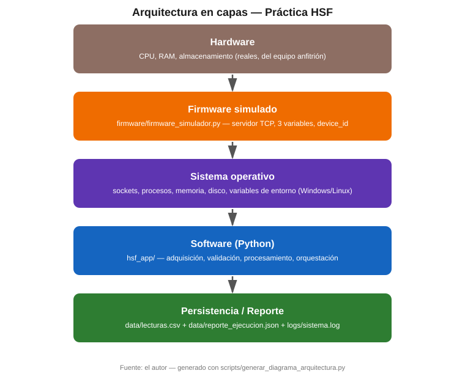
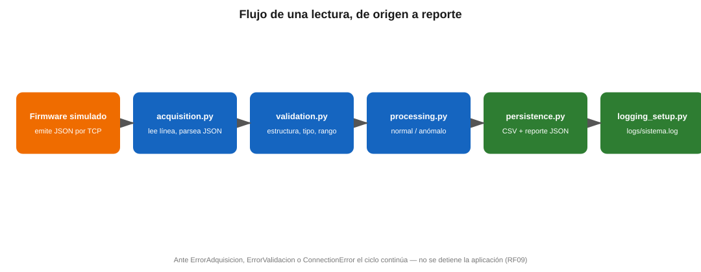

**Universidad Santo Tomás — Facultad de Ingeniería en Tecnologías de la Información y las Comunicaciones**
**Programa:** Ingeniería en Informática
**Estudiante:** [NombreEstudiante] — **Código:** [Codigo]
**Entrega:** Segundo corte, práctica de integración HSF
**Fecha:** [dd de mes de 2026]
**Repositorio:** <https://github.com/USUARIO/REPOSITORIO> *(reemplazar por la URL real)*

---

## 1. Introducción y contexto

Este documento sustenta el prototipo entregado para el Anexo 3 de la evaluación del segundo corte: un sistema que recorre las cuatro capas de un sistema informático — hardware, firmware, sistema operativo y software de aplicación — capturando datos de un dispositivo, procesándolos y generando información útil para la toma de decisiones.

No se dispuso de una placa física para esta práctica, por lo que el firmware se simula íntegramente en software (decisión justificada en la sección 3), siguiendo explícitamente una de las alternativas que la guía habilita: *"cuando no se disponga de una placa física, el firmware puede simularse mediante un microcontrolador virtual, un script que emule telemetría o una fuente de datos controlada"*.

Todo el código, las pruebas y la evidencia citados en este documento están en el repositorio de GitHub referenciado arriba, y son reproducibles ejecutando los comandos que se indican en `README.md`.

## 2. Arquitectura de la solución

La arquitectura sigue el flujo recomendado por la guía: *Hardware → Firmware → Comunicación → Sistema operativo → Python → Persistencia/Reporte → Usuario*.

| Capa | Responsabilidad en este prototipo | Archivo |
|---|---|---|
| Hardware | CPU, RAM y disco reales del equipo donde corre todo el prototipo | — (recursos del SO anfitrión) |
| Firmware | Genera telemetría de 3 variables (temperatura, humedad, vibración) con identificador de dispositivo, cada 1 s, e inyecta una anomalía cada 7 ciclos | `firmware/firmware_simulador.py` |
| Comunicación | Socket TCP (`127.0.0.1:8765`), un mensaje JSON por línea | `hsf_app/acquisition.py` |
| Sistema operativo | Expone sockets, procesos, memoria, disco y variables de entorno; la app los consulta directamente | `hsf_app/os_resources.py` |
| Software | Valida, clasifica, orquesta el ciclo completo y expone el estado de la integración | `hsf_app/*.py` |
| Persistencia/Reporte | CSV de lecturas + reporte JSON con métricas agregadas | `hsf_app/persistence.py`, `data/` |

El flujo de una lectura individual, con el punto exacto donde cada tipo de error se intercepta sin detener la aplicación, se muestra en el siguiente diagrama:

## 3. Decisiones técnicas y justificación

**Firmware 100 % simulado en Python, sobre socket TCP.** Se evaluaron tres alternativas que ofrece la guía: hardware real (Arduino/ESP32/Raspberry Pi), Wokwi, y un script de telemetría. Se descartó el hardware real porque introduce una variable de falla externa al código el día de la grabación del video (una placa que no conecta invalida la demostración completa). Se descartó Wokwi porque depende de un servicio web de terceros y complica la reproducibilidad del docente al clonar el repositorio. El script de telemetría sobre TCP, en cambio, corre igual en cualquier máquina con Python, sin instalar nada adicional, y de paso ejercita una capa de comunicación real basada en servicios del sistema operativo (sockets), que es exactamente lo que pide evaluar el Anexo 3.

**Python modular, no un único script.** El paquete `hsf_app/` separa adquisición, validación, procesamiento, recursos del SO, persistencia y orquestación en archivos distintos con una única responsabilidad cada uno. Esto no es una preferencia estética: permite probar cada pieza de lógica de forma aislada (TDD real, no simulado) y es exactamente lo que pide el requisito no funcional de mantenibilidad del Anexo 3.

**TDD real, no retroactivo.** Las 27 pruebas de `tests/` se escribieron antes que su implementación correspondiente, confirmando en rojo antes de pasar a verde (ver historial de commits). Esta disciplina encontró un defecto real durante la construcción: antes de envolver `registrar_lectura_csv` en un `try/except`, una ruta de persistencia inaccesible tumbaba toda la aplicación — una violación directa del RF09. Se corrigió escribiendo primero la prueba que exigía el comportamiento correcto (`test_ejecutar_continua_si_falla_la_persistencia`).

**CSV para la serie de datos, JSON para el reporte.** El RF07 acepta CSV o JSON; se usan ambos formatos en su rol natural: CSV para una serie temporal tabular fácil de abrir en cualquier hoja de cálculo, JSON para un resumen jerárquico (métricas + snapshot de recursos del SO) que no encaja bien en filas y columnas.

**Reconexión con backoff exponencial, no reintento inmediato.** Un reintento inmediato y constante satura la red o el proceso remoto si la caída es prolongada. El backoff creciente (`1, 2, 4, 8` segundos) da tiempo a que el firmware se recupere sin convertir la aplicación en un bucle ocupado.

## 4. Trazabilidad de requisitos

| Requisito | Cómo se cumple | Evidencia |
|---|---|---|
| RF01 — Identificar el dispositivo | Cada trama trae `device_id`; el firmware escribe `firmware/device_manifest.json` | `firmware_simulador.py::escribir_manifiesto` |
| RF02 — Recibir datos periódicamente | El firmware emite cada 1 s; la app lee en bucle continuo | `acquisition.py` |
| RF03 — Validar estructura, tipo y rango | `validar_lectura` revisa los 5 campos, sus tipos y sus rangos físicos | `validation.py` + 6 pruebas |
| RF04 — Clasificar condición normal/anómala | `clasificar_lectura` compara contra umbrales operativos por variable | `processing.py` + 5 pruebas |
| RF05 — Registrar eventos y errores | Logging a consola y a `logs/sistema.log`, con nivel, evento y resultado | `logging_setup.py` |
| RF06 — Consultar el sistema operativo | CPU, memoria, disco, PID del proceso y variables de entorno en cada reporte | `os_resources.py` + 2 pruebas |
| RF07 — Persistir en CSV o JSON | `data/lecturas.csv` (serie) + `data/reporte_ejecucion.json` (resumen) | `persistence.py` + 3 pruebas |
| RF08 — Reporte resumido de ejecución | Métricas agregadas + snapshot de recursos al cierre | `app.py::MetricasEjecucion.resumen` |
| RF09 — Recuperarse de una falla sin perder el control | Errores de adquisición, validación, persistencia y conexión se cuentan y se continúa; nunca un traceback no controlado | `app.py::OrquestadorHSF.ejecutar` + 5 pruebas + 6 fallos reales (ver §6) |
| RF10 — Mostrar el estado de la integración | Log de "integración activa" al conectar, estado final impreso al cierre | `app.py::main` |

**No funcionales:** seguridad (no se ejecuta ningún comando de sistema ni se interpreta la entrada como código — solo se parsea como JSON y se valida campo por campo); confiabilidad (ver RF09); rendimiento (ver §7, latencia medida); mantenibilidad (ver §3); observabilidad (ver RF05); portabilidad (ver pregunta 9 en §8); escalabilidad (ver pregunta 6 en §8).

## 5. Resultados de pruebas

27 pruebas automáticas en `tests/`, todas en verde (`pytest tests/ -v`), cubriendo validación, clasificación, recursos del SO, adquisición (con sockets reales en hilo local), persistencia y el orquestador completo (incluyendo reconexión y fallas de persistencia). La matriz completa, cruzando cada caso con su evidencia automática y manual, está en `docs/Matriz_Pruebas.md`.

Además de las pruebas automáticas, se ejecutó el sistema real end-to-end: firmware simulado y aplicación como dos procesos independientes, generando `data/lecturas.csv`, `data/reporte_ejecucion.json` y `logs/sistema.log` con datos reales (no inventados) — 20 lecturas, 2 de ellas anómalas por diseño del simulador.

## 6. Fallos controlados

Se ejecutaron los 6 fallos que pide el Anexo 3 §11 contra el sistema real (no simulados a mano): desconexión permanente de la fuente, dato con formato incorrecto, ruta de persistencia sin acceso, variable fuera de rango, saturación de CPU, e interrupción temporal de la red con recuperación. El detalle completo — causa, síntoma, detección, respuesta, evidencia real de consola y mejora propuesta para cada uno — está en `docs/Fallos_Controlados.md`. El hallazgo más relevante: el fallo de "ruta sin permisos" expuso durante la construcción un punto real donde la aplicación no era tolerante a fallas (RF09), corregido antes de la entrega gracias a TDD (ver §3).

## 7. Indicadores técnicos (Anexo 3 §12)

| Indicador | Cómo se midió | Meta sugerida | Resultado real |
|---|---|---|---|
| Disponibilidad de comunicación | lecturas recibidas / intentos de lectura, corrida con desconexión real (fallo 6) | ≥ 95 % | 40/41 ≈ **97.6 %** |
| Latencia | diferencia entre el `timestamp` del firmware y el instante de recepción, 15 lecturas sobre loopback | definir por caso | promedio **0.254 ms**, máxima **0.375 ms** (localhost; con un dispositivo físico remoto sería mayor) |
| Datos válidos | lecturas válidas / lecturas recibidas, agregado de todas las corridas reales (base + 4 fallos) | ≥ 98 % | 63/64 ≈ **98.4 %** |
| Tasa de errores | errores / eventos totales, agregado de todas las corridas reales | ≤ 5 % | **6.1 %** agregado (0 % en la corrida base sin fallos inyectados; el agregado sube porque dos de las corridas inyectan errores deliberadamente para la demostración de fallos del §6) |
| Tiempo de recuperación | fin de la desconexión real → primera lectura normal de nuevo (fallo 6) | definir por caso | **3.57 s** |

La tasa de errores agregada por encima del 5 % es intencional y se explica: dos de las cinco corridas que alimentan este promedio son, por diseño, corridas de fallos controlados (§6), no operación normal. En operación normal (corrida base, sin fallos inyectados) la tasa de errores fue 0 %.

## 8. Preguntas de integración

**¿Qué responsabilidad pertenece al hardware y cuál al firmware?** En este prototipo, "hardware" es el equipo anfitrión real (CPU, memoria, disco) sobre el que corre todo el proceso; su responsabilidad es puramente ejecutar instrucciones y ofrecer recursos. El "firmware" (`firmware_simulador.py`) es la capa que decide *qué* dato generar, con qué forma y cada cuánto — la lógica de bajo nivel específica del dispositivo. **¿Dónde se produce realmente cada transformación de datos?** La generación del valor crudo ocurre en el firmware; su serialización a JSON y el envío por el socket, en la frontera firmware-comunicación; la deserialización, validación y clasificación, en `hsf_app` (software de aplicación); la persistencia final, en la frontera software-sistema operativo (llamadas a archivo).

**¿Qué servicios del sistema operativo utiliza la aplicación Python?** Sockets TCP (comunicación), el sistema de archivos (lectura/escritura de CSV, JSON y logs, con creación de directorios), y consultas de CPU, memoria, disco, PID del proceso y variables de entorno a través de `psutil` y los módulos estándar `os`/`platform`.

**¿Qué ocurre si el sistema operativo revoca permisos sobre un recurso utilizado por la aplicación?** Se demostró en el fallo 3 (§6): la llamada de escritura lanza `OSError`, el `try/except` en `app.py` la captura, se cuenta como `errores_persistencia`, se registra en el log, y el ciclo principal continúa — la lectura ya validada no se pierde de vista, solo no queda en disco esa vez.

**¿Qué ventajas y limitaciones tiene usar Python frente a C/C++ o Rust en una integración con dispositivos?** Ventajas: velocidad de desarrollo, manejo de excepciones expresivo (clave para RF09), un ecosistema rico para validación, persistencia y pruebas (pytest), y portabilidad casi directa entre Windows y Linux. Limitaciones: el GIL impide paralelismo real de CPU dentro de un mismo proceso (se evidenció al construir el fallo 5 — hubo que usar `multiprocessing`, no hilos, para saturar CPU de verdad); el rendimiento por operación es menor que C/C++/Rust, lo que importa si el dispositivo exige temporización de microsegundos; y Python no es apto para programar el firmware de un microcontrolador real de gama baja, donde C/C++ (o Rust para seguridad de memoria) siguen siendo el estándar.

**¿Qué parte del sistema debería ejecutarse en firmware y cuál en software de aplicación? Justifique.** Todo lo que exige temporización estricta y bajo nivel —muestreo del sensor, manejo directo del protocolo físico— pertenece al firmware, porque ahí la latencia y el determinismo importan más que la expresividad. Todo lo que exige lógica de negocio, validación compleja, persistencia estructurada y observabilidad pertenece al software de aplicación, porque ahí la mantenibilidad y la velocidad de iteración importan más que los microsegundos. Mezclar ambas cosas en una sola capa dificulta probar y mantener el sistema, como demuestra la separación en módulos de este prototipo.

**¿Cómo cambiaría la arquitectura si se conectaran 100 dispositivos simultáneamente?** El modelo actual (un socket por conexión atendido secuencialmente, `listen(1)`) no escala a eso. Se necesitaría: un servidor TCP asíncrono o con pool de hilos/procesos que acepte múltiples conexiones en paralelo; identificar cada dispositivo en la capa de persistencia (hoy el CSV asume un único `device_id` implícito en el flujo, aunque el campo ya viaja en cada lectura); y probablemente una cola de mensajes (p. ej. MQTT, que la guía ya habilita) en vez de sockets TCP directos, para desacoplar la velocidad de ingestión de la velocidad de procesamiento.

**¿Qué riesgos de seguridad aparecen al recibir datos externos o ejecutar comandos del sistema?** El riesgo principal es tratar el dato recibido como código o como una ruta/comando sin sanear — por eso `acquisition.py` solo pasa la línea cruda por `json.loads` (nunca por `eval` ni por un shell), y `validation.py` rechaza cualquier estructura que no coincida exactamente con el esquema esperado antes de que el dato llegue a cualquier otra capa. Un segundo riesgo es la denegación de servicio por datos malformados repetidos; se mitiga contando `errores_adquisicion` sin dejar que un dato corrupto aborte el proceso.

**¿Cómo garantizaría integridad y trazabilidad de los datos?** Cada lectura persistida queda con su `timestamp` de origen y su `estado` (normal/anómalo) en el mismo renglón del CSV; cada evento relevante (lectura, error, reconexión) queda en `logs/sistema.log` con fecha/hora y nivel. Para un entorno de producción, se añadiría un hash o firma por lote de lecturas y un identificador de sesión de ejecución, para poder demostrar que el archivo no fue alterado después de generado.

**¿Qué diferencias podrían presentarse entre Windows y Linux?** Se comprobaron dos directamente durante esta práctica: los mensajes de error de socket difieren textualmente (`WinError 10054`/`10061` en Windows, frente a `ConnectionResetError`/`ConnectionRefusedError` con `errno` POSIX en Linux, aunque ambos se capturan con el mismo `except ConnectionError`/`OSError` porque Python los normaliza a la misma jerarquía de excepciones); y la ruta de los ejecutables y el manejo de procesos en segundo plano cambia (en este prototipo, `scripts/ejecutar_demo.ps1` y `scripts/ejecutar_demo.sh` existen por separado precisamente por eso). `psutil` abstrae la mayoría de las diferencias de bajo nivel en la consulta de recursos del SO.

**¿Cómo diseñaría una estrategia de actualización del firmware sin afectar el servicio?** Con dos versiones del firmware corriendo en paralelo (azul-verde): la nueva versión se levanta en un puerto o canal distinto, se valida con tráfico de prueba, y solo entonces la aplicación conmuta su conexión hacia ella; la versión anterior se mantiene disponible un tiempo prudencial por si hay que revertir. Esto evita la ventana de indisponibilidad de actualizar en el mismo proceso que está sirviendo datos.

**¿Qué pruebas adicionales aplicaría antes de llevar el prototipo a producción?** Pruebas de carga sostenida (horas, no segundos, para detectar fugas de memoria o descriptores de archivo sin cerrar); pruebas de seguridad (fuzzing del parser JSON con entradas adversariales, no solo una línea corrupta); pruebas de concurrencia real con múltiples dispositivos; y pruebas de recuperación ante caída del propio proceso de la aplicación (hoy se prueba la caída del firmware, falta probar qué pasa si la app muere a mitad de una escritura de CSV).

**¿Qué componente sería el principal punto de falla y cómo lo convertiría en un componente tolerante a fallos?** El socket único hacia un único firmware es el punto de falla más evidente: si cae y no vuelve, no hay datos, como se demostró en el fallo 1. Para tolerarlo, se introduciría redundancia (más de una fuente de datos o un *failover* automático a una fuente secundaria) y se separaría la adquisición de la persistencia mediante una cola intermedia, para que una caída de la fuente no bloquee el resto del pipeline ni haga esperar indefinidamente a quien consume los datos persistidos.

## 9. Conclusiones

El prototipo demuestra, con evidencia real y no simulada a mano, el recorrido completo que exige la guía: desde la generación de un dato en una capa de firmware hasta su persistencia y reporte, pasando por servicios reales del sistema operativo anfitrión. La disciplina de TDD no fue un formalismo: encontró un defecto de tolerancia a fallas real antes de la entrega. Los 6 fallos controlados, ejecutados contra procesos reales (no mockeados) demuestran que el sistema cumple el RF09 en la práctica, no solo en la teoría: ninguno de los 6 escenarios tumbó la aplicación.

La limitación más relevante del prototipo es su escala: funciona para un dispositivo a la vez por diseño, y la pregunta de la sección 8 sobre 100 dispositivos simultáneos señala exactamente dónde habría que invertir el siguiente esfuerzo de ingeniería.

## 10. Referencias (APA 7)

Martinez Barrera, C. (2026). *Evaluación segundo corte — Integración de Sistemas de Información 2026-2* [Guía de práctica]. Universidad Santo Tomás, Facultad de Ingeniería en Tecnologías de la Información y las Comunicaciones.

Python Software Foundation. (2026). *Python 3 documentation — socket, json, logging, multiprocessing*. https://docs.python.org/3/

Rodola, G. (2026). *psutil documentation*. https://psutil.readthedocs.io/

Microsoft. (2026). *Windows Sockets error codes*. Microsoft Learn. https://learn.microsoft.com/windows/win32/winsock/windows-sockets-error-codes-2
